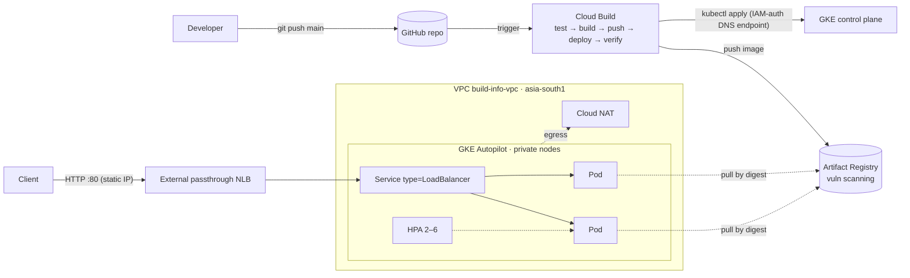

# build-info-api

A small Node.js (Fastify) service that exposes **`GET /build-info`**, returning the
build metadata of the running artifact (version, git commit, branch, build time,
CI build id) plus which pod/node answered. Deployed to a **private GKE Autopilot**
cluster on GCP via **Cloud Build**, with all infrastructure in **Terraform**.

```json
GET /build-info
{
  "build": {
    "app_name": "build-info-api",
    "version": "1.0.0",
    "git_commit": "3f2c1ab",
    "git_branch": "main",
    "build_time": "2026-10-11T10:00:00Z",
    "build_id": "b1d2e3f4-..."
  },
  "runtime": {
    "environment": "dev",
    "pod_name": "build-info-api-7d9c8b6f5-x2k4p",
    "pod_namespace": "build-info",
    "node_name": "gk3-build-info-dev-pool-2-1a2b3c4d-xyz",
    "node_version": "v22.12.0",
    "uptime_seconds": 532
  },
  "timestamp": "2026-10-11T10:08:52+00:00"
}
```

Other endpoints: `/healthz` (liveness), `/readyz` (readiness).

---

## Architecture



| Layer | Choice |
|---|---|
| App | Node.js 22 LTS, Fastify (JSON-schema validated response, pino JSON logs), build info baked in at image build time |
| Container | Single-stage `node:22-slim`, `npm ci --omit=dev`, non-root `node` user, read-only rootfs in the pod |
| Compute | GKE **Autopilot**, regional, private nodes, Release channel REGULAR |
| Network | Custom VPC, VPC-native secondary ranges, Private Google Access, Cloud NAT |
| Exposure | `Service type=LoadBalancer` (`loadBalancerClass: l4-regional-external`) → regional external passthrough NLB on a reserved static IP, `loadBalancerSourceRanges` allow-list |
| Control plane access | IAM-authenticated **DNS endpoint**; IP endpoint closed except optional admin CIDRs |
| Registry | Artifact Registry (regional), cleanup policies, Container Scanning |
| CI/CD | Cloud Build with a dedicated least-privilege SA; deploy **by digest**; post-deploy commit verification |
| IaC | Terraform, GCS remote state |
| K8s config | Kustomize base + `dev` overlay |

Reasoning and trade-offs for each decision: **[docs/DESIGN.md](docs/DESIGN.md)**.
Interview demo script and Q&A prep: **[docs/WALKTHROUGH.md](docs/WALKTHROUGH.md)**.

---

## Repository layout

```
src/app.js          Fastify app (routes, schema, logging)
src/server.js       entrypoint: listen + graceful SIGTERM shutdown
test/               node:test unit tests (no extra test framework)
Dockerfile          simple single-stage, non-root image
cloudbuild.yaml     CI/CD pipeline
k8s/base            Deployment, Service, HPA, PDB, NetworkPolicy, Namespace (PSA restricted)
k8s/overlays/dev    environment-specific config
terraform/          VPC, NAT, GKE Autopilot, Artifact Registry, IAM, Cloud Build trigger
docs/               design decisions + walkthrough
Makefile            common commands
```

---

## Run locally

```bash
make install       # npm ci
make test          # eslint + node --test
make run           # http://localhost:8080/build-info
make docker-run    # same, but inside the production image
```

## Deploy to GCP

**Prerequisites:** Node.js 22, `gcloud`, `terraform >= 1.6`, `kubectl` (+ `gke-gcloud-auth-plugin`), a GCP project with billing.

### 1. Bootstrap (once)

```bash
export PROJECT_ID=<your-project> REGION=asia-south1
gcloud config set project $PROJECT_ID
gcloud auth application-default login

# Versioned bucket for Terraform state
gcloud storage buckets create gs://$PROJECT_ID-tfstate --location=$REGION --uniform-bucket-level-access
gcloud storage buckets update gs://$PROJECT_ID-tfstate --versioning
```

### 2. Infrastructure

```bash
cp terraform/terraform.tfvars.example terraform/terraform.tfvars   # edit project_id etc.
cd terraform
terraform init -backend-config="bucket=$PROJECT_ID-tfstate"
terraform plan -out tfplan
terraform apply tfplan          # ~10 min, mostly the GKE cluster
```

### 3. First deployment (manual pipeline run)

```bash
cd ..
make deploy PROJECT_ID=$PROJECT_ID   # runs cloudbuild.yaml from your working tree
make creds                            # kubectl via DNS endpoint
make smoke                            # curl the public endpoint
# or: curl http://$(terraform -chdir=terraform output -raw api_ip)/build-info
```

### 4. Continuous deployment (push to `main`)

1. Push this repo to GitHub.
2. Install the **Google Cloud Build** GitHub App on the repo (Console → Cloud Build → Triggers → Connect repository). This OAuth step is the only manual one.
3. Set `create_build_trigger = true`, `github_owner`, `github_repo` in `terraform.tfvars` and `terraform apply`.

Every push to `main` touching the app, Dockerfile, manifests or pipeline now tests, builds, pushes, deploys by digest and verifies the live pods report the new commit.

### Tear down

```bash
kubectl delete -k k8s/overlays/dev   # removes the LB first (avoids orphaned forwarding rules)
cd terraform && terraform destroy     # requires deletion_protection = false
```

---

## Verifying a deployment

```bash
curl -s http://<API_IP>/build-info | jq .build.git_commit     # == git rev-parse --short HEAD
for i in $(seq 6); do curl -s http://<API_IP>/build-info | jq -r .runtime.pod_name; done   # load spread across pods
kubectl -n build-info get deploy,po,svc,hpa,pdb
```

## Troubleshooting

| Symptom | Check |
|---|---|
| Service stuck `<pending>` external IP | `kubectl -n build-info describe svc build-info-api`; static IP name in the annotation must match `google_compute_address.api` (`build-info-api-ip`) and be in the cluster's region. Requires GKE ≥ 1.29. `loadBalancerClass` is immutable – delete/recreate the Service if you change it. |
| `get-credentials --dns-endpoint` denied | Caller needs `container.clusters.connect` (in `roles/container.developer`). |
| Pods rejected on create | Namespace enforces PSA `restricted`; check `kubectl get events -n build-info`. |
| `ImagePullBackOff` | Node SA needs `artifactregistry.reader` on the repo (Terraform grants it). |
